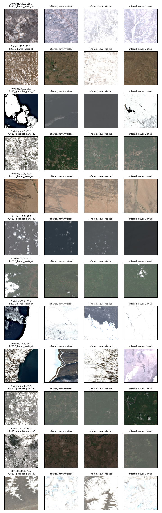

# Hikes 29.10 reflection: why the walkers still go back (2026-11-01)

Prompted by the question: why do the agents return to tiles so often when they have other options, and is it because those tiles are far more interesting than the alternatives? Numbers and the figure come from `analysis/h2910_revisits.py`.

**Short answer: mostly no.** A walker choosing blindly on the same map revisits almost as often, so most of the returning comes from the shape of the walk. Interest adds a little to how often the agents return, and decides much of where. Only the small group of favourite tiles scores far above its surroundings.

**Data:** ten walks with fixed perception (`score_crops: fixed`, fresh archive latents, normalised latents), 18,000 steps: Reference, Bored, Globalist and Localist from Milan, two seeds each, and Bored and Globalist from Paris. The Fast learner is left out because its seed 1 collapsed (`observations.md`, part 1, §5). **A stay** is a stretch between two steps longer than 30 km, what `observations.md` calls a place. Score comparisons skip the first 50 steps, while the running z-scores are still warming up.

This updates `notes/03_planet_walks/reflection_revisits.md`, which described the walker before the perception fixes. That walker's novelty *rose* with visits, and one tile reached 255 visits. Neither is true any more.

## A blind walker returns too

Each stay was replayed as a blind walk: same landing tile, same number of steps, uniform choice among the real neighbours (20 replays per 1,000-step walk, 6 per 5,000-step walk).

| Mean over the ten walks | Agents | Blind replay |
|---|---|---|
| steps on an already-visited tile | 53.3 % | 46.4 % |
| straight back to the tile just left (A→B→A) | 26.6 % | 14.9 % |
| unique tiles, agents as a share of blind | 88 % | – |
| most visits to one tile | 8.7 | 9.9 |

A tile has only 6–7 neighbours, and the one just left is always among them, so a blind walker steps straight back about one time in seven and soon crosses its own path. Interest adds about 7 points of revisiting and makes straight-back steps 1.8× as common. Two of the ten walks (Reference seed 1, Localist seed 0) revisit slightly less than their blind replays, though within one standard deviation of them.

## The agents do favour seen tiles, but usually not by much

An unvisited tile was on offer on about 99 % of steps with a choice. Seen tiles were 37 % of the options and 54 % of the choices. The walk's own probabilities give the same 54 %, so the choices follow the scores and are not an accident of the sampling.

Seen tiles win without usually being far ahead. On the 16,857 steps offering both seen and new tiles (typical spread of I within a step: 1.16):

- The best seen tile beats the best new tile by a median of **+0.21** in I (quartiles −0.57 and +1.16), about 1.5:1 odds at temperature 0.5. It leads on 57 % of steps.
- The *average* seen tile leads the average new tile by more (median +0.80), but the choice is usually between the best of each.
- 35 % of returns went to a tile that was not the top candidate, and 20 % to a tile scored below a new tile on offer.

## The favourites really are far ahead

A tile's first look comes before any visit, so visits can't have caused its score. It predicts how often the tile will be visited:

| Visits over the whole walk | Tiles at first look | I vs. the other options | n_z | g_z | Raw novelty |
|---|---|---|---|---|---|
| never | 11,979 | −0.46 | −0.25 | −0.19 | 0.22 |
| 1 | 3,711 | +0.30 | +0.22 | +0.18 | 0.28 |
| 2 | 1,681 | +0.70 | +0.73 | +0.28 | 0.34 |
| 3–4 | 1,496 | +1.36 | +1.43 | +0.35 | 0.43 |
| 5–6 | 633 | +2.11 | +2.29 | +0.34 | 0.54 |
| more than 6 | 166 | +3.03 | +3.27 | +0.36 | 0.64 |

The lead comes almost entirely from novelty. Tiles with 5 or more visits are 10 % of all visited tiles and take 42 % of the returns, so they are a real attraction but do not account for most returns. Half of all visited tiles got no return at all.

## Why a return doesn't use up the interest

**A visit lowers interest, and it does so on every visit.** Comparing a tile's two looks at most 10 steps apart:

| | Pairs of looks | Change in raw novelty | Change in n_z | Change in g_z | Change in I |
|---|---|---|---|---|---|
| visited in between | 16,710 | −0.048 | −0.42 | −0.25 | **−0.67** |
| not visited | 71,403 | −0.001 | −0.01 | +0.03 | +0.02 |

The drop is about the same whether it is the first visit or the eighth (−0.64 to −0.70). So the perception fixes worked: familiarity now builds. A tile keeps being chosen because it started high: a tile that has just had its first visit still has a mean I of +0.63, against −0.27 for an average unvisited option.

**Familiarity builds slowly by design.** Novelty is the mean distance to the 10 nearest archive entries (`k_nn: 10`), so one more copy of a tile should remove only about a tenth of it. That is a reading of `signals.novelty`, not a separate test. It fits the data: mean raw novelty falls from about 0.30 at 3 prior visits to 0.06 at 9, and the one candidate with 10 prior visits has exactly 0. No tile got more than 10 visits in 18,000 steps. This cap should not be overstated, because the blind replays average only 9.9 visits on their busiest tile.

## "Places" versus tiles

Every return is a local loop within the current stay. Of the 9,605 returns, **none** crossed a jump, and none of the 368 jumps landed within 30 km of an earlier stay. Jumps and teleports are blind draws from 2.18 million tiles, so no walker has yet found its way back to a place it left. Three stays of the Paris Globalist, as an example:

| Stay (`narration/out/tests/test_research.md`) | Steps | Unique tiles | Revisit share | Most visits to a tile |
|---|---|---|---|---|
| Kivalliq Region, Nunavut | 24 | 13 | 0.46 | 3 |
| Bay of Bengal off Andhra Pradesh | 37 | 21 | 0.43 | 6 |
| Zhegu, Tibet | 181 | 87 | 0.52 | 6 |

## What the favourites are

The two Paris walks have 225 tiles with 6 or more visits. Compared with never-visited tiles offered alongside them, their median grey-level standard deviation is 39 against 15, a median ratio of 2.2. A favourite has more contrast than those neighbours in 79 % (Bored) and 91 % (Globalist) of cases.

By eye, in the figure, they are snow on rock, ice floes, and cloud on dark sea. Some of this may reflect the acquisition date rather than the place, since each tile has its own date: around 44 N, 85.7 W the favourites are snowy and near-white, and the neighbours they beat are green or brown and snow-free. That is a hypothesis from a few examples, not a measurement.

## What it means

- **Revisit share is a weak measure of character.** It should be read against a blind replay. This refines `observations.md`, part 1, §1: the "habit" of revisiting about half the time, which sets the tile count, is largely the geometry of the walk.
- **A return is weak evidence of attraction.** For the narration, a tile visited twice says little. A high first-look score, or five or more visits to one tile, says much more.
- **The straight-back step has both causes.** About 15 of the 27 points are geometry. Blocking it with `no_backstep` would change the walk regardless of why it happens, so it should be read as a change of temperament, as `notes/03_planet_walks/reflection_revisits.md` says. Not tested here.

## Caveats

- The blind replay keeps the real landing tiles and stay lengths, and curiosity and boredom partly set those lengths. So it measures choice within a stay and misses any effect of interest on how long a stay lasts.
- The agents' options are 37 % seen, while a blind walker's are about 46 % (with uniform choice, its revisit rate equals that share). So 37 % is not a neutral baseline for the 54 %. Why the agents keep more new tiles within reach was not investigated.
- The revisit gap varies by walk (from −2 to +16 points), and each character has only two or three walks. The mean across walks is firmer than any one character's figure.
- Interest is a z-score over about 50 steps, so "far ahead" means relative to recent surroundings, not on an absolute scale.
- The contrast comparison covers only the two Paris walks and looks at pixels, not at what the network sees.
