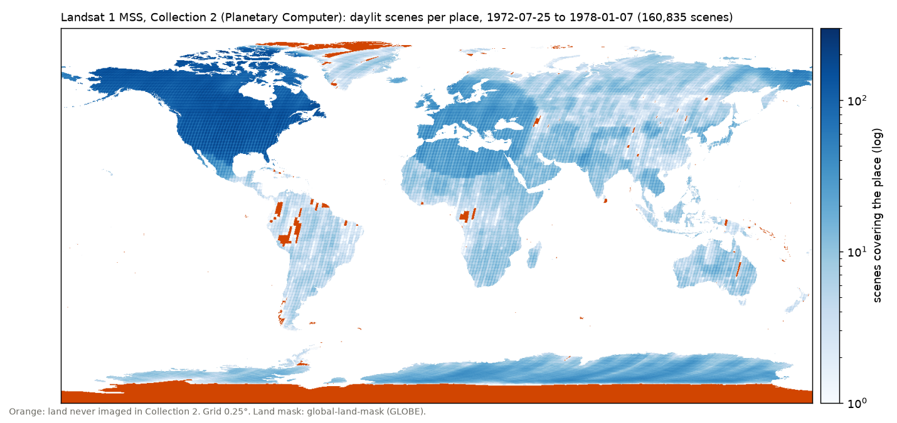

# Research: a world made of the whole Landsat 1 mission (2026-11-11)

Moe's question: where to get the aggregate data of the Landsat 1 mission (not one pass), and what, if anything, changes for the setup. Moe's interest is in the quirks of the apparatus: MSS artefacts, broken pixels, clouds. Research only: nothing has been built or walked. Numbers come from a census of the catalogue (`analysis/landsat1/census.py`) and a probe of image windows (`analysis/landsat1/quirk_probe.py`, results in `results/quirk_probe.csv`).

## Short version

- **Source: Microsoft Planetary Computer**, collection `landsat-c2-l1`, as in e10. No account; every band and both QA bands are Cloud Optimized GeoTIFFs, so one 10 km cell can be read on its own (about 0.37 MB, 1.3 s). It holds 162,111 Landsat 1 scenes. USGS's own STAC lists 176,012, so about 8 % are missing from the free mirror; the rest are on USGS EarthExplorer (account) or on AWS (requester pays).
- **No ready-made aggregate exists.** Major TOM gave a world with one acquisition per 10 km cell. For Landsat 1 we build the index ourselves from the catalogue: a grid, plus a rule that picks which acquisition each cell shows. That rule is a premise and is Moe's to set.
  - The one published mosaic, GLS1975, mixes Landsat 1–5, is chosen for low cloud and is orthorectified. It is the cleaned version of what interests us here.
- **The archive is the apparatus's portrait.**
  - 98 % of land outside Antarctica was imaged at least once, but unevenly: a median of 120 scenes per place in North America against 4 in South America.
  - 77 % of land was imaged in the first five months (Jul–Dec 1972) and 90 % in 1973. From 1975 on, 15–27 % a year. 67 % of land was imaged only in 1972–73.
  - Only 1.7 % of scenes reach Tier 1. 60 % are L1GS, systematic geometry that USGS says "may be offset from its correct spatial location by thousands of meters".
- **The quirks are in the data, and the QA bands measure them badly.**
  - Line defects are not flagged: the dropped-pixel bit was never set in 56 sampled scenes, while e10's stripe measure finds them (median 1.4 % of pixels, up to 43 %).
  - Saturation flags do not match the pixels.
  - The cloud mask is effectively binary.
  - Clouds and bad geometry come together: median window cloud 25 % in L1GS scenes, 0.1 % in L1TP. Any filter for "good" scenes also removes the clouds and most of the tropics.
- **The walker needs no change.** The cell size, pixel size, eye and compass scale of e10 carry over.
  - What changes is the world-building: grid, selection rule, a lazy store over COG windows, TOA conversion per scene, and quirk columns per cell.
  - The readouts change too. The seam readout becomes informative; the WorldCover readouts become anachronistic.
- **This reopens the world decision of 2026-11-11** (Major TOM), and with it milestone 1 (the GAN prototype on `e09_v1_long_s0`).

## Where the data is

| Source | Access | What it holds | For us |
|---|---|---|---|
| **Planetary Computer** `landsat-c2-l1` | Free, no account. STAC search; anonymous SAS token for the files | 162,111 Landsat 1 items (25 Jul 1972 – 7 Jan 1978). COG bands green, red, nir08, nir09 (MSS 4–7), QA_PIXEL, QA_RADSAT, MTL (txt/xml/json) | **The base.** e10 already uses it (`data/landsat_pass.py`). Windowed reads work. |
| **USGS STAC** (landsatlook.usgs.gov/stac-server), collection `landsat-c2l1` | Free search; files via EarthExplorer (EROS account) or AWS | 176,012 Landsat 1 items | The reference count. Which ~14k are missing from Planetary Computer is not yet checked (open check 1). |
| **AWS** `s3://usgs-landsat/collection02/` (us-west-2) | Requester pays: egress costs fall on us | "Landsats 1, 2, 3, 4, 5, 7, 8, and 9". The MSS prefix is not confirmed on an official page | Only for scenes missing from Planetary Computer. |
| **USGS EarthExplorer / M2M API** | EROS account; bulk download | The full archive | The same, as whole-scene bundles. |
| **Google Earth Engine** `LANDSAT/LM01/C02/T1`, `.../T2` | Earth Engine account; export quotas | Tier 1 and Tier 2 | Server-side compositing. We need tiles, not composites, so it is not needed. |
| **GLS1975** (`LANDSAT/GLS1975`, `LANDSAT/GLS1975_MOSAIC`; also EarthExplorer) | Earth Engine / EROS | One curated, low-cloud scene per place, Landsat 1–3 (1972–83), gaps filled with Landsat 4–5 (1982–87) | Not Landsat 1 alone, and curated *against* the quirks. Possibly a contrast world: the archive as an institution cleaned it. |
| Sentinel Hub "Landsat 1-5 MSS L1" | Commercial account | Collection 2 L1 | No advantage. |

Collection 1 is gone ("no longer available to download from the USGS as of December 30, 2022"). Collection 2 is the only processing there is. Licence: "There are no restrictions on the use of Landsat products."

## The mission in numbers (census of Planetary Computer, 2026-11-11)

| | |
|---|---|
| Scenes | 162,111 (160,835 daylit, 1,276 at night) |
| Mission | first light 25 Jul 1972; decommissioned 6 Jan 1978 |
| Per year (all) | 1972: 21,950 · 1973: 48,262 · 1974: 39,061 · 1975: 23,319 · 1976: 20,406 · 1977: 9,015 · 1978: 98 |
| Processing level | L1TP 65,484 (2,792 Tier 1, 62,692 Tier 2) · L1GS 96,627 (all Tier 2) |
| Scene cloud cover (daylit) | median 22 %, quartiles 3 % / 59 %; 39 % of scenes ≤ 10 % |
| WRS-1 path/rows imaged | 14,768; scenes per path/row median 4, mean 11, max 88 |

Land coverage (0.25° grid, area-weighted, Antarctica excluded unless stated):

| Land imaged by … | share |
|---|---|
| any scene | 0.983 (all land incl. Antarctica: 0.965; south of 81° S is beyond the orbit) |
| a scene with ≤ 20 % cloud | 0.911 |
| an L1TP scene | 0.912 |
| a Tier 1 scene | 0.137 |

| Region | covered | clear (≤ 20 %) | L1TP | median scenes per place |
|---|---|---|---|---|
| North America | 1.00 | 0.99 | 0.99 | 120 |
| Europe | 1.00 | 0.99 | 1.00 | 27 |
| Africa | 0.99 | 0.94 | 0.94 | 9 |
| Asia | 1.00 | 0.90 | 0.97 | 7 |
| Oceania | 0.98 | 0.94 | 0.93 | 6 |
| South America | 0.93 | 0.81 | 0.66 | 4 |

Land imaged in a given year: 1972 0.77 · 1973 0.90 · 1974 0.43 · 1975 0.27 · 1976 0.27 · 1977 0.15. **67 % of land was imaged in 1972–73 and never in 1975–77.**

What the map shows:
- **North America is saturated.** It was in range of the ground stations.
- **A halo of dense coverage** around Europe, North Africa and the Middle East.
- **The rest of the world in WRS-1 stripes,** from the period when two wideband video tape recorders could store 30 min of data each for playback over the ground stations (NASA).
- **Holes:** the western Amazon, the Andes, the Congo basin and strips of Siberia were never imaged.

USGS: "about 75 % of the Earth's surface"; NASA: "collected over 300,000 scenes". So about half of what was acquired is not in Collection 2.

Not confirmed (a tool's summary of an unread part of NASA's page, not checked): that the tape recorders failed in 1972 and 1974, after which the satellite relied on real-time downlinks. The timing would match the drop in coverage from 1974.

## The quirks, and what the products do with them

From USGS pages, the MSS Collection 2 Data Format Control Book (LSDS-1416 v3) and the probe of 56 scenes (central 512 × 512 px windows; up to 4 daylit scenes per year and processing level).

| Quirk | What the product records | Probe (56 windows) |
|---|---|---|
| **6-bit sensor** ("N = 6 bits for MSS"), delivered as 8-bit DN (TOA via MTL scaling) | `QUANTIZE_CAL_*` per band | 78–255 distinct levels per band after resampling to 60 m (median 128 in green). The 64-level comb is smeared by resampling. Not checked whether it survives in the histogram. |
| **Line defects** (bad scan-line segments, coloured stripes; e10) | QA_RADSAT bit 9 "Dropped Pixel: detector doesn't have a value" | **Bit 9 set in 0 of 56.** e10's stripe measure: median 1.4 %, p90 8 %, max 43 % of pixels. L1GS 2.8 %, L1TP 0.4 % (cloud edges count too). |
| **Saturation** | QA_RADSAT bits 0–6 per band | Green flagged on > 1 % of pixels in 41 % of windows, sometimes the whole window; pixels at 255: mean 8 % against 11 % flagged. The flag and the data disagree (as e10 saw). |
| **Clouds** | QA_PIXEL bit 3 and confidence bits 8–9, from "the MSS cloud mask algorithm (Cubist model)"; no shadow, no snow class | The cloud bit and high confidence are identical in every window: a binary mask. Window cloud: median 1.4 %, p90 78 %. |
| **Geometry** | Level L1TP (ground control + DEM) or L1GS (systematic); tier | USGS: "Landsat TM and MSS images may be offset from its correct spatial location by thousands of meters"; L1GS "will require manual registration". 60 % of Landsat 1 is L1GS. |
| **Memory effect** (light and dark bands next to sharp bright–dark edges) | Not flagged | USGS: "It exists in most MSS data"; "most modern processing systems correct ME by default". Whether Collection 2 has erased it is not checked. |
| **Impulse noise** (bit flips of ±32/64/128 DN) | Not flagged | USGS lists it for all sensors and shows it on Landsat 2 tape data. Not measured. |
| **Fill** | QA_PIXEL bit 0 | 0.2 % of window pixels (scene edges). |
| **Night scenes** | sun elevation ≤ 0 | 1,276 scenes (79 % L1GS). |

**Clouds and geometry are entangled.** Median window cloud is 25 % in L1GS scenes against 0.1 % in L1TP: precision correction fails where clouds hide the ground control. A world restricted to L1TP or Tier 1 loses most clouds, most of South America (L1TP covers 66 % of it) and most of the stripes.
- **Tier 1** would leave 14 % of land.
- **For the quirks, keep every level**, and give each cell its level, tier, cloud, stripe and saturation as readout columns (as e10's `stripe`). Then a readout can ask whether the walker is drawn to them.

## What changes for the setup

**Unchanged.** Walker v1 itself (`agent/walk.py`, `agent/compass.py`), and e10's scale: cells of 10.68 km = 178 native 60 m pixels → 256 px (41.7 m/px). The 64 px crop is still a ~2.7 km eye at ~83 m/px, just coarser than MSS's 79 m, so the eye loses almost nothing. r_min 15 km, the snap floor of 7.5 km and r_max 2,000 km keep their meaning on a global world.

**To build:**
1. **The grid.** The Major TOM grid is the natural choice. It keeps the cells, the `cover` column and the land/ocean mask comparable with every Major TOM walk.
   - The alternative is e10's per-UTM-zone grid, which leaves gaps where zones meet.
   - Roughly 1.2 million cells of land outside Antarctica (area ÷ 114 km²).
2. **The selection rule (a premise, Moe's)**: which acquisition a cell shows.
   - **Earliest**, as our Major TOM index (`data/global_index.py` keeps the earliest product per cell): the satellite's first look. About three quarters of the world then dates from Jul–Dec 1972, with North America from the first weeks.
   - **Latest**: the last look. For the two thirds of land never imaged after 1974 this is still 1972–73; North America and the station halos move to 1976–77.
   - **Random**: as Major TOM itself.
   - **Least cloudy**: a curation against the quirks, close to GLS1975.
   - **Keep every acquisition**: a world with time depth, where an offer can be the same place on another day. This changes the compass (offers in time as well as space), so it is a new walker design, not a world.
   - Whatever the rule, a cell covered by several overlapping scenes of one pass needs a tie-break (e10: nearest to its scene's centre).
3. **A lazy store over COG windows**, like `data/tile_store.TileStore` over Major TOM.
   - The index (cell → scene, window) is built offline from the census (metadata only, done: 23 MB).
   - A tile is read when it is offered: about 0.37 MB and 1.3 s per cell for 4 bands and both QA bands, in the same order as a Major TOM thumbnail (150–250 kB). It is cached on disk.
   - Prebuilding all cells would be about 450 GB (1.2 M × 0.37 MB), so prebuild only on the PC, if at all.
   - The SAS token expires and must be renewed (as the signed CDN URLs in `TileStore`).
4. **Radiometry per scene.** TOA reflectance from the MTL (M · DN + A) / sin(sun elevation): one small MTL read per scene, cached. Then e10's tone (sqrt) and one global stretch.
   - Sun angle, season and the per-scene calibration become seams between cells. As stored, not equalised.
   - The Landsat 2–3 CPF error in the known issues does not affect Landsat 1.
5. **The eye's colour.** MSS has no blue band. The eye is CIR (nir08 / red / green, e10's default), or a synthetic natural colour (e10's `pseudo`), or a 4-band eye.
   - Every film frame and every GAN sample will be in that colour.
   - nir09 (0.8–1.1 µm) is left out of a 3-band eye.
6. **Quirk columns per cell**, never shown to the walker:
   - level (L1TP/L1GS), tier, cloud share (QA bit 3), fill, e10's stripe share, flagged saturation per band, share at DN 255;
   - scene id, path/row, date, sun elevation;
   - optionally, a check for 6-bit level combs.

**Readouts:**
- **Seams become informative.** In Major TOM, neighbouring cells almost never share a datatake (seam share 1.00, e09 finding 65). In a Landsat 1 world, cells along one path share a pass. Seam crossing then means something, and so do L1GS offsets at scene borders.
- **Land cover becomes anachronistic.** WorldCover (2020/21) labels for 1972 images: the Aral Sea, the Amazon frontier and cities have moved. The planned RQ3 drift readout (a land-cover classifier trained on real tiles) has no contemporary labels.
  - A classifier trained on Major TOM RGB would not transfer to CIR MSS.
  - This is a conceptual question for Moe: which "human-legible properties" a 1972 world can be read against.
- **Coverage density is a property of the world.** With one acquisition per cell it disappears from the tiles but stays in the dates (North America from the first weeks).

**Plan and devices:**
- The world decision of 2026-11-11 (Major TOM) and milestone 1 are planned on `e09_v1_long_s0`. A Landsat 1 world means either a new long walk in it before the GAN, or the GAN prototype on Major TOM and Landsat 1 for the replication.
- The index build, the store and the walks fit the Mac. Bandwidth today was about 0.3 MB/s, which is about one new cell per second. A 15,000-step walk with fresh offers is then hours of fetching, as on Major TOM.
- GAN training stays on the PC, where a prebuilt cache of the visited cells could also live.

## Rendered tiles (added 2026-11-11, `analysis/landsat1/render_quirks.py`)

Rendering as e10's world: TOA reflectance, square root, e10's fixed stretch, CIR. Nothing repaired.

- `figures/quirks_sheet.png`: eight cells with their flags. Columns: the walker's tile, 48 native pixels ×5, and the flags. Single tiles at 512 px: `figures/quirks_tile_*.png`.
  - **Clean** (Tier 1, Eastern Desert): only 71 of 160,835 daylit scenes are Tier 1, cloud-free, with the sun above 45° and land at their centre.
  - **Line defects** (1974, 1972): bright and dark segments 1–2 native lines thick, in single bands, so they show as green, magenta and orange streaks along the scan lines. They cover 37–47 % of the cell. The saturation flag also lights up along many of them.
  - **Saturation flag without saturation**: 99 % of the cell flagged, no pixel at 255. Thin lines in the green band show blue in CIR.
  - **Real saturation** (high Arctic, May): the whole cell at DN 255, a white tile. Defect lines run diagonally through it.
  - **Snow and cloud** (Labrador, May): QA cloud on half the cell, DN 255 on a quarter. The cloud mask cannot tell snow from cloud.
  - **Missing data**: a band of fill ~2.5 km wide across the scene, along the scan lines.
  - **Night** (sun −15°): no ground at all, only a regular pattern of red and green lines. The saturation flag is set on 70 %. Probably the detectors' dark signal (the period has not been measured).
- `figures/resolution_paris.png`: the Paris cell (Major TOM `543U_17R`, Sentinel-2 22 Sep 2020) against Landsat 1, 21 Sep 1976.
  - Shown three ways: the 10.68 km cell, the walker's 2.67 km eye, and the 32 × 32 px the network gets.
  - The 21 Sep 1976 scene has a haze plume over the city although its cloud cover is 0.
- `figures/offset_paris.png`: **the L1GS offset, measured once.** In the L1GS scene of 30 Apr 1976, Paris is drawn 21.7 km from where it is (16.2 km north, 14.4 km east). Phase correlation on nir08 against the L1TP scene; cell correlation 0.61 moved against −0.04 in place.
  - At the cell's own coordinates that scene shows fields two cells away.
  - In a Landsat 1 world built from L1GS scenes, a cell's name and its ground part by kilometres. Neighbouring cells from different scenes can repeat or skip ground.

**Resolution, in short.**
- MSS was 79 m native (57 × 79 m sampling), delivered at 60 m: 178 px a cell, against 1,068 px at Sentinel-2's 10 m. Six times coarser in each direction, 36 times fewer pixels.
- **The walker hardly notices.** Its tile is 256 px (41.7 m/px) in both worlds, and its eye (a 64 px crop shrunk to 32 px) sees about 83 m per pixel. That is just coarser than MSS's 79 m, so MSS loses almost nothing. Sentinel-2 is thrown away at that scale anyway.
- At the network's input the two look alike, except that MSS is softer and carries its stripes.
- **It matters for everything shown at full size:** film frames, any GAN at a native-resolution crop, and the "hires" path `TileStore.get_hires` gives Major TOM. A full-frame MSS cell is 178 px, so a 1080p frame is a 6× enlargement.

**Zoom levels** (`figures/zoom_levels.png`, `analysis/landsat1/render_zoom.py`; full 1080 × 1080 frames in `data/landsat/zoom/`, git-ignored).
- Two places (Paris, 21 Sep 1976; the Eastern Desert, 14 May 1975), each framed at six widths: 2.7 km (the walker's eye, data enlarged ×24), 5.3 km (×12), 10.7 km (one cell, ×6), 21.6 km (×3), 32.4 km (×2) and 64.8 km (1:1).
- **×24 and ×12 are blur. ×6 (one cell) is soft. From ×3 down the frame looks sharp, and at ×2 and 1:1 it shows the data rather than the interpolation.**
- For the film this means frames covering about 20–65 km of ground. The resolution is fixed by the sensor (~79 m), so zooming out shows more ground at the data's own sharpness; it does not add detail.
- Seen only when zoomed out:
  - Paris's "haze" is a set of parallel diagonal streaks across the region (contrails or cloud streets?), on a day of 0 % listed cloud.
  - The "clean" Tier 1 desert scene carries pale scan-line defects 10–30 km from the cell picked for the quirk sheet. Even the cleanest scenes have stripes somewhere.

## Decisions for Moe

1. **The world:** Landsat 1 replaces Major TOM, or sits next to it (a second world for the same walker).
2. **The selection rule** per cell (earliest / latest / random / least cloudy / every acquisition).
3. **Levels kept:** all (recommended, for the quirks), or L1TP only, or Tier 1 only. What is dropped goes with its clouds and stripes.
4. **The eye's colour:** CIR, pseudo-natural, or 4 bands.
5. **Night scenes** (1,276): in or out.
6. **What a 1972 world is read against** (land cover from 2020, or no land-cover readout).

## Open checks (cheap, before building)

1. Which ~14k Landsat 1 items USGS lists that Planetary Computer does not (year, level, region). If they cluster (e.g. one region or period), the mirror's gap is itself a seam.
2. L1GS offsets: measured once (Paris, 21.7 km; `figures/offset_paris.png`). Still to do: their distribution over a sample of L1GS/L1TP pairs.
3. Memory effect and impulse noise in Collection 2: probe the bright–dark edges (snow, coasts) and DN jumps of ±32/64/128.
4. Whether the 64-level comb survives in the 8-bit histograms of homogeneous areas.
5. Coverage per cell on the Major TOM grid under each selection rule: dates, levels and cloud of the resulting world.

## Sources

- USGS, Landsat 1: https://www.usgs.gov/landsat-missions/landsat-1
- NASA, Landsat 1: https://science.nasa.gov/mission/landsat-1
- USGS, Collection 2 Level-1: https://www.usgs.gov/landsat-missions/landsat-collection-2-level-1-data
- USGS, levels of processing (tier table, MSS geometry): https://www.usgs.gov/landsat-missions/landsat-levels-processing
- USGS, MSS Level-1 data products: https://www.usgs.gov/centers/eros/science/usgs-eros-archive-landsat-archives-landsat-1-5-multispectral-scanner-mss-level
- USGS, MSS Collection 2 L1 DFCB (LSDS-1416 v3): https://www.usgs.gov/media/files/landsat-1-5-mss-collection-2-level-1-data-format-control-book
- USGS, QA bands: https://www.usgs.gov/landsat-missions/landsat-collection-2-quality-assessment-bands
- USGS, known issues: https://www.usgs.gov/landsat-missions/landsat-known-issues · https://www.usgs.gov/landsat-missions/landsat-collection-2-known-issues · memory effect https://www.usgs.gov/landsat-missions/memory-effect · striping https://www.usgs.gov/landsat-missions/detector-striping · impulse noise https://www.usgs.gov/landsat-missions/impulse-noise
- AWS registry: https://registry.opendata.aws/usgs-landsat/
- Planetary Computer, Landsat: https://planetarycomputer.microsoft.com/dataset/group/landsat
- Earth Engine: https://developers.google.com/earth-engine/datasets/catalog/LANDSAT_LM01_C02_T1 · https://developers.google.com/earth-engine/datasets/catalog/LANDSAT_LM01_C02_T2 · GLS1975 https://developers.google.com/earth-engine/datasets/catalog/LANDSAT_GLS1975_MOSAIC
- Sentinel Hub, Landsat 1-5 MSS L1: https://docs.sentinel-hub.com/api/latest/data/landsat-mss/
