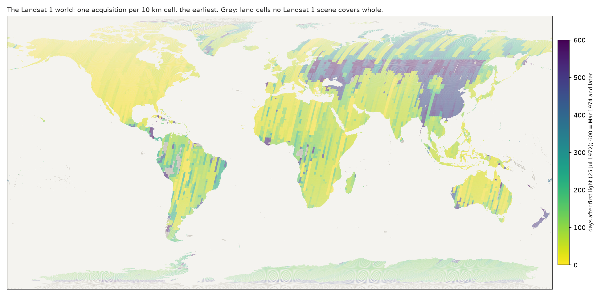
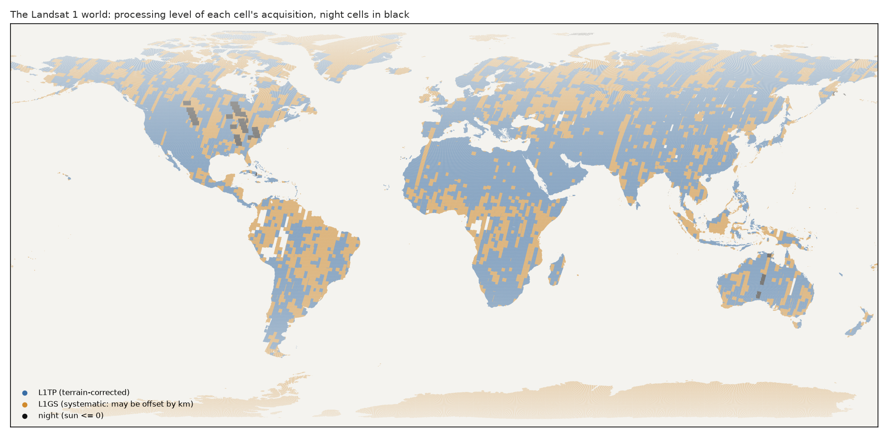

# The Landsat 1 world: portrait (2026-11-12)

Brief: `notes/brief_landsat_pipeline.md`, A1–A6. Code: `data/landsat1_world.py` (grid, candidates, selection), `data/landsat1_store.py` (lazy store, radiometry, quirks), `analysis/landsat1/portrait.py` (this note's tables and figures). Data in `data/landsat1/` (git-ignored): `grid.parquet`, `candidates.parquet` (446 MB), `scenes.parquet`, `index.parquet`, `world.json`, `baseline.parquet`, `cache/`.

## Short version

- **1,466,863 cells**, one acquisition each: 96.8 % of the Major TOM grid's 1,516,016 land and coast cells (97.9 % outside Antarctica).
- **Three quarters of the world is from 1972.** 77 % of cells show an acquisition from Jul–Dec 1972, 19 % from 1973, 3.4 % from 1974–76. The median cell was imaged on 28 Sep 1972, nine weeks after first light.
- **The world is mostly L1TP but 40 % L1GS** (systematic geometry, may be offset by km). Tier 1 is 1.9 %. Antarctica is entirely L1GS.
- **12,280 night cells (0.8 %).** Most come from the mission's first weeks (25 Jul – 23 Aug 1972): under the earliest rule, the satellite's commissioning night passes become part of the world. They form whole strips across the US Midwest (4.5 % of North America) and central Australia.
- **The quirks are common.** In 2,000 random cells: a median of 5.7 % QA cloud (46 % of cells over 10 %), stripes over 1 % of pixels in half of all cells, DN 255 in 37 % of cells, and the saturation flag disagreeing with the pixels on more than 1 % in 56 %. Clouds, stripes and saturation are concentrated in L1GS cells.
- **What is set by hand:** the grid (Major TOM's), the land mask, the coverage rule (whole cell inside a footprint), the selection rule (earliest, nearest scene centre on ties), the window (178 px in the scene's own pixel grid), the radiometry (TOA; night without the sun term), the tone (sqrt) and the one stretch. **What follows from the archive:** everything in the tables below.

## How it was built

| Step | What | Numbers |
|---|---|---|
| Grid | Major TOM's 10 km grid (`grid_rows`, `grid_cols`), cell centre = grid point + 5 km east and north in the point's UTM zone | 5,094,350 cells in ±85°; centres match Major TOM's archive for 99.96 % of its land and coast cells, distance 0.000 km (p95) |
| Land mask | global-land-mask, 5 × 5 points over the 10.68 km cell; any land point keeps the cell | 1,516,016 cells (1,425,449 land, 90,567 coast) |
| Candidates | Every Landsat 1 scene whose STAC footprint holds the cell's centre and four corners | 33,981,755 (cell, scene) pairs; 1,466,863 cells covered; median 7 candidates per cell (North America 101) |
| Window | 178 × 178 px (10.68 km) centred on the cell, in the scene's own projection and pixel grid | 1,604 pairs fall off the raster by 1–94 px and are dropped |
| Selection | Earliest day; ties (overlapping scenes of one pass) to the scene with the nearest centre | `select_earliest`; other rules are functions in `SELECT` |

Two things found on the way:
- **The catalogue's EPSG codes are wrong for UTM zones 1–9.** Planetary Computer's `proj:epsg` drops the zero (3265 for 32605) on 27,171 of the 162,111 Landsat 1 items. The COGs carry the right CRS. The code reads them as the zones they name and keeps the catalogue's value in `epsg_catalogue`. Before the fix, 2.96 M windows fell outside their raster.
- The census had no raster geometry, so it was queried again (`analysis/landsat1/census.py items_proj`, 162,111 items, a few minutes).

## Coverage and dates by region

`results/world_regions.csv`. "covered" is the share of the grid's land and coast cells in the world.

| Region | grid cells | covered | median date | 1972 | 1973 | 1974+ | L1GS | Tier 1 | scene cloud (median %) | night |
|---|---|---|---|---|---|---|---|---|---|---|
| Africa | 335,904 | 0.99 | 1972-09-16 | 0.94 | 0.05 | 0.01 | 0.27 | 0.043 | 8 | 0.000 |
| Asia | 420,515 | 0.99 | 1972-11-27 | 0.53 | 0.40 | 0.08 | 0.30 | 0.015 | 15 | 0.001 |
| Europe | 83,448 | 1.00 | 1972-09-25 | 0.64 | 0.24 | 0.12 | 0.32 | 0.007 | 12 | 0.000 |
| N America | 226,038 | 1.00 | 1972-08-06 | 0.99 | 0.01 | 0.00 | 0.41 | 0.027 | 13 | 0.045 |
| Oceania | 102,889 | 0.97 | 1972-08-24 | 0.90 | 0.08 | 0.01 | 0.35 | 0.006 | 3 | 0.017 |
| S America | 182,591 | 0.93 | 1972-10-20 | 0.75 | 0.24 | 0.01 | 0.57 | 0.002 | 10 | 0.000 |
| Antarctica | 116,074 | 0.83 | 1972-12-08 | 0.79 | 0.20 | 0.01 | 1.00 | 0.000 | 79 | 0.000 |
| All | 1,516,016 | 0.97 | 1972-09-28 | 0.77 | 0.19 | 0.03 | 0.40 | 0.019 | 13 | 0.008 |

Cells by year: 1972 1,134,727 · 1973 281,549 · 1974 46,574 · 1975 3,391 · 1976 622. 7.7 % of the world dates from the first week (before 1 Aug 1972).

- **North America is the satellite's first look:** imaged in the first weeks, from the ground stations.
- **Russia and China are the late world.** A band from the Volga to the Pacific and most of China were first imaged in 1974 (dark in the map). For the walker, crossing into them is crossing 18 months.
- **Holes:** the western Amazon, the Congo basin, Patagonia's edges, strips of Siberia and the Antarctic interior (grey). They are not in the world: the compass snaps across them.
- Antarctica's cells are L1GS, with a median scene cloud of 79 %. The cloud mask cannot tell snow from cloud.

Month histogram: `figures/world_dates_hist.png` (`results/world_months.csv`).

## Quirks in 2,000 random cells (pixels, `results/world_quirks_baseline.csv`)

Measured when a cell is first fetched (`data/landsat1_store.quirk_arrays`), on the 178 px window. Stripe, DN 255, flag and disagreement are the maximum over the three bands the eye sees (green, red, nir08).

| Quirk | mean | median | p90 | cells > 1 % | cells > 10 % |
|---|---|---|---|---|---|
| QA cloud | 0.28 | 0.057 | 0.97 | 0.59 | 0.46 |
| fill | 0.004 | 0 | 0.0001 | 0.03 | 0.01 |
| stripe (e10's measure) | 0.048 | 0.011 | 0.15 | 0.51 | 0.15 |
| DN 255 | 0.13 | 0.0005 | 0.58 | 0.37 | 0.24 |
| saturation flag | 0.22 | 0.027 | 0.93 | 0.58 | 0.39 |
| flag xor DN 255 | 0.13 | 0.023 | 0.41 | 0.56 | 0.32 |
| dropped-pixel bit | 0 | 0 | 0 | 0 | 0 |

By level (medians, `results/world_quirks_by_level.csv`): L1GS cloud 0.35 against L1TP 0.005; stripe 0.025 against 0.005; DN 255 0.045 against 0; saturation flag 0.21 against 0.001. The research note's finding holds at the cell level: clouds, stripes and saturation come with bad geometry. The cell's QA cloud and its scene's listed cloud correlate (Spearman 0.84).

## The one view

- TOA reflectance from each scene's MTL; night cells as M · DN + A without the sun term, flagged. Fill (QA bit 0, or DN 0 in any band) is black.
- e10's sqrt tone, then one stretch for the whole world: percentiles 0.5–99.5 of 397,600 valid pixels from the 1,988 daylit baseline cells. In sqrt reflectance (nir08, red, green): low (0.048, 0.037, 0.000), high (0.98, 0.92, 0.99). The top is set by snow, ice, cloud and saturation, so ordinary land sits near pixel value 90–100 (Major TOM's thumbnails ~100) and bright ground has little headroom.
- CIR (nir08, red, green), 178 → 256 px bilinear, as e10's build. Checked: the store's `render` reproduces e10's sqrt pass world pixel for pixel (537 cells, largest difference 0).
- nir09 is cached (float16) and never seen.

## The store

`Landsat1TileStore`, with `TileStore`'s interface; `world: landsat1` in a config. Per cell, six COG window reads (four bands, QA_PIXEL, QA_RADSAT) plus one STAC item and one MTL per scene, both cached. Eight cells at once, six attempts with exponential backoff, SAS token renewed every 30 min and on HTTP 403. A cell in the cache is ~0.38 MB (TOA float16, the two QA windows, its quirks).

Baseline fetch: 2,000 cells in 410 s, none failed, no retries; 1.6 s per cell (median, 2.2 s p95), 4.9 cells/s with eight at once. 741 MB on disk.

## Not done, open

- Open checks 1–5 of the research note (missing ~14k items, L1GS offset distribution, memory effect, impulse noise, 6-bit combs) are still open.
- Readouts against land cover: not built (brief). Every cell carries its grid cell name and coordinates for later joins.
- Other selection rules: not built. `SELECT` takes a function.
