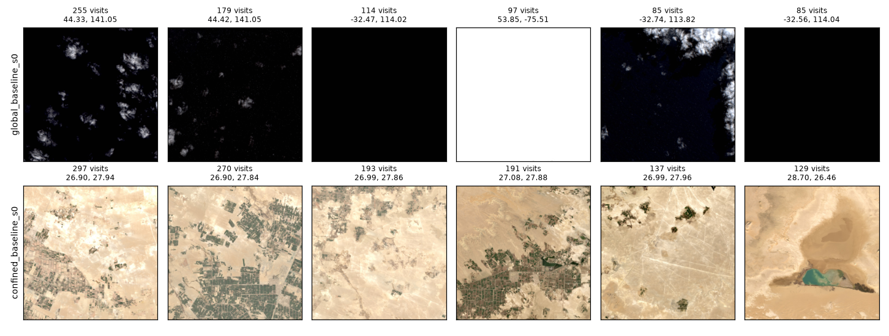

# Dreams v3 reflection: why the walkers keep going back (2026-10-28)

Prompted by stepping through the walks in `runs/<run>/hike.html` (`analysis/hike_viewer.py`): the walkers keep returning to the same tile, often straight back to the one they just left. Numbers and the figure come from `analysis/v3_revisits.py` (`python analysis/v3_revisits.py runs/global_baseline_s0 runs/confined_baseline_s0`).

v1 already saw this (`notes/observations.md`, findings 2–4: agents dwell, the Alps behave like a natural noisy TV, learning progress loves dark sea). v3 shows that it holds at planet scale, and the measurements below locate most of the cause in how the agent perceives a tile, not in what it likes.

## What happens

| | global walker | confined walker | v1 `baseline_s0` (regional) |
|---|---|---|---|
| steps on an already-visited tile | 78.7 % | 76.9 % | 80.3 % |
| A → B → A (straight back) | 43.0 % | 28.3 % | 32.1 % |
| came-from tile chosen, vs uniform choice | 43.4 % vs 17.4 % | 28.6 % vs 19.1 % | 32.5 % vs 17.5 % |
| share of steps on the 20 favourite tiles | 34.6 % | 38.0 % | 45.1 % |
| most-visited tile | 255 visits | 297 visits | 68 visits |

- These are true repeats of the same tile id. No grid cell appears under two tile ids, so duplicate imagery isn't involved. Neighbouring tiles in uniform terrain (open sea, sand) also look alike at 256 px, which adds to the impression but not to the counts.
- The global walker spends long stretches shuttling between two adjacent tiles of black sea off Hokkaido, 10 km apart (255 and 179 visits). Its other favourites are flat black sea off Western Australia and a flat white (clipped) tile near Hudson Bay. 15 of its top 20 tiles are ocean.
- The confined walker settles on the oasis farmland around 26.9° N, 27.9° E, where dark field grids sit against bright sand. Its top four tiles together take 951 of 5,000 steps.

## Why: three mechanisms

**1. Every look draws new random crops, so a seen tile never becomes familiar.** A tile's embedding is the mean latent of K = 16 random 64 px crops, redrawn each time it is a candidate (`agent/signals.patches`). With each run's final autoencoder I embedded every visited tile twice, with independent crops, and compared that distance with the distance to the 10 nearest *other* visited tiles:

| tiles visited | global: same tile, two looks | global: 10 nearest others | confined: same tile | confined: others |
|---|---|---|---|---|
| once | 0.50 | 0.58 | 0.20 | 0.23 |
| 4–10 times | 0.66 | 0.68 | 0.27 | 0.31 |
| more than 30 times | 0.62 | 0.66 | 0.98 | 0.83 |

A second look at the same tile moves its embedding almost as far as switching to another tile. The archive does fill with copies of a favourite (after 255 visits, its 10 nearest archive entries are all itself), but they don't lower its novelty. The noise is largest for tiles whose crops differ most: cloud puffs on black sea, dark fields on bright sand, and in v1 snow against rock. In the confined run the tiles visited more than 30 times have 4–5× the crop-to-crop spread and 4× the pixel contrast of tiles visited once. This is a noisy TV produced by the sampling, not by the world. v1's finding 1 showed that averaging over 16 crops makes *i.i.d.* noise familiar after one visit. It doesn't help when the variation is spatial structure that each draw samples differently.

**2. Flat extremes stay attractive for a different reason.** Pure black sea and clipped white have no crop noise at all: two looks give the identical latent. Yet during the walk they kept a raw novelty of 0.9–2.2, while their distance to the 10 nearest other tiles under the final model is 0.13 or less. Their learning-progress z was +0.5 to +1.2. Learning progress is v1 finding 3 again: a flat image is trivial to relearn and is forgotten between visits, so every return pays. The novelty is probably stale archive latents: archive entries are encoded at visit time and re-embedded only every 100 steps, and the encoding of a constant image moves with every update. That part is a hypothesis and not tested.

**3. Nothing stops the walker from going back.** Candidates are all tiles within 15 km, about 6 on the 10 km grid, so the tile just left is always among them. It was chosen for scoring high, so it usually still scores high (came-from tile: n_z +0.68 vs −0.18 for the other candidates in the global run). There is no visit cost and no inhibition of return, and boredom fires only when even the best candidate has I < 0, which an attractor pair prevents.

All three together give the picture in the candidate log: **in the global run, novelty rises with the number of prior visits.**

| prior visits of a candidate | 0 | 1 | 2–3 | 4–10 | 11–30 | > 30 |
|---|---|---|---|---|---|---|
| raw novelty n | 0.74 | 0.75 | 0.82 | 0.95 | 1.02 | 1.21 |
| learning progress g_z | −0.17 | −0.14 | −0.05 | +0.06 | +0.44 | +0.79 |
| chosen (uniform ≈ 16 %) | 8 % | 10 % | 13 % | 20 % | 32 % | 59 % |

In the confined run novelty does dip after a first visit (0.68 → 0.58) before rising again for the favourites (1.08 above 30 visits), and the choice bias is weaker (14 % → 32 % against a uniform 17–21 %).

## What it means for dreams v3

- **The walk's strongest preference doesn't reach the dreamer.** `agent_path` weights each *unique* tile by its first-visit surprise and boredom (`gen/build_sets.tile_weights`). Where the walker spent its time (a third of all steps on 20 tiles) doesn't enter the GAN data: the Hokkaido tile with 255 visits counts the same as a tile passed once. This is defensible if the dreams should be built from *where it went*. It is a gap if they should reflect *what held its attention*. Weighting by visits or dwell time would change the agent dataset a lot, and towards black sea and oasis fields.
- **Part of the walker's "taste" is a perception artefact.** Contrast-rich tiles win partly because random crops make them look new every time. v1 called the Alps a natural noisy TV; the measurements here show the noise is in the sampling. Claims about what the agent *likes* should be made with that in mind.
- **The dream search is free of mechanism 1 but not of 2.** `gen/dream_search.py` scores with deterministic views (crop_px 64 → the whole 64 px image, 16 identical views), so crop noise doesn't apply. Its objective is learning progress, which favoured flat extremes on the walk. The agent is frozen during the search, so forgetting between visits doesn't apply either, but this is worth checking: do the top dreams at low reach drift to flat black or white, rather than to the "structured garbage" the expectation predicts?

## Options for the revised hikes

Ordered from the one that changes the agent least to the one that changes its character most:

1. **Fixed crops for scoring** (e.g. crop positions seeded by tile id; keep random crops for training). This removes mechanism 1 and is the cleanest test of it: if the revisit rate and the back-step rate drop, the sampling was the cause.
2. **Fresher archive latents.** Re-embed a candidate's own archive entries when it reappears, or re-embed more often than every 100 steps. This tests the stale-latent part of mechanism 2.
3. **Normalised latents for novelty** (L2 or cosine). In the global run, latent norm grows with visit count (4.4 for tiles visited once → 8.6 above 30 visits), so raw Euclidean distance also rewards "loud" tiles.
4. **A visit cost or inhibition of return** (−β·log(1 + visits) in I, or drop the came-from tile from the candidates). This works regardless of cause, but it is a change of temperament, not a fix. The dwelling also has value: v1 read it as *episodes*, closer to dramaturgy than a diffusing walk.

Options 1 and 2 are corrections to perception and could go in without changing what the agent is meant to be. Option 4 is the artist's call.

## Caveats

- The two-looks measurement uses each run's *final* model. During the walk the model and the archive changed between looks, which adds drift on top of the crop noise measured here.
- One seed per world. v1's dwelling numbers (25–32 % back-steps over 20 runs) suggest the effect is robust, but the v3 attractor tiles are specific to these two walks.
